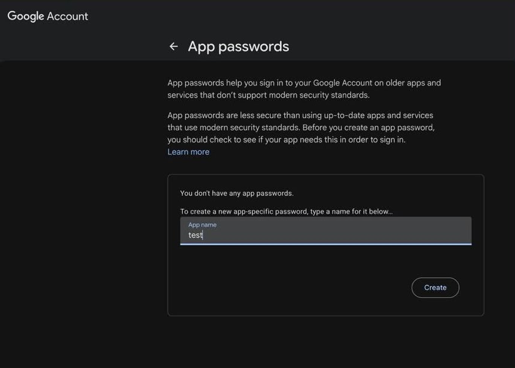
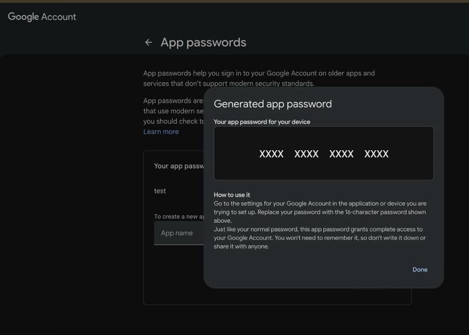

# Gmail Bulk Email & CV Sender

A lightweight, zero-dependency Python 3 script (`send_mail.py`) that sends the same email—along with optional **PDF attachments** (such as a CV/resume)—individually to a list of contacts using **Gmail SMTP** and a **Google App Password**.

All settings, credentials, recipient emails, message content, and PDF paths are loaded strictly from `.env` (no hardcoded values in the code).

---

## How It Works

1. **Loads Configuration from `.env`**: Reads SMTP settings, sender credentials, recipient list, email subject/body, and PDF attachment paths from `.env` (and any exported OS environment variables).
2. **Validates Everything Upfront**:
   - Checks all required `.env` variables and validates email formats (`mail_list` deduplicates repeated addresses automatically).
   - Verifies that any configured `pdf_attachments` exist on disk and are valid PDF files.
   - Automatically strips spaces from `gmail_app_key`.
3. **Simulation Mode (`dry_run="true"`)**: Builds the full MIME message (including PDF attachments) for every contact and previews the exact output without connecting to Gmail or sending real emails.
4. **Live Sending (`dry_run="false"`)**:
   - Connects securely once to `smtp.gmail.com` (SSL on port `465`, or STARTTLS if `smtp_use_ssl="false"`).
   - Sends an **individual email** to each contact in `mail_list` so recipients only see their own address in `To:` (protecting recipient privacy).
   - Waits `send_delay` seconds between messages to respect SMTP rate limits.

---

## How to Get Your Gmail App Password (`gmail_app_key`)

Google does not allow scripts to log in with your regular Gmail password. Instead, you must generate a **16-character Google App Password**:

### Step 1: Turn On 2-Step Verification
1. Open your Google Account Security page: **[https://myaccount.google.com/security](https://myaccount.google.com/security)**
2. Under **"How you sign in to Google"**, select **2-Step Verification** and turn it **ON**.
   > **Important:** You **must** enable 2-Step Verification first—Google will not allow access to App Passwords until 2-Step Verification is active.

### Step 2: Create an App Password
1. Once 2-Step Verification is enabled, open the App Passwords page: **[https://myaccount.google.com/apppasswords](https://myaccount.google.com/apppasswords)**
2. Type any **App name** (for example, `test` or `Mail Sender`) and click **Create**:



### Step 3: Copy the Generated Key into `.env`
1. Google will display a **Generated app password** popup containing your **16-character key**:



2. Copy that 16-character password and paste it into `gmail_app_key` in your `.env` file (with or without spaces—the script strips spaces automatically) before clicking **Done**.

---

## Quick Start

### 1. Create Your `.env` File
Copy the example environment file:

```bash
cp .env.example .env
```

*(Note: `.env` is listed in `.gitignore` so your App Password and contact list are never committed to Git.)*

### 2. Configure `.env`
Edit `.env` with your details, message, recipients, and optional PDF file(s):

```dotenv
# SMTP server configuration
smtp_host="smtp.gmail.com"
smtp_port="465"
smtp_use_ssl="true"
smtp_timeout="30"

# Sender credentials
gmail_sender="your.email@gmail.com"
sender_name="Your Name"
gmail_app_key="xxxx xxxx xxxx xxxx"

# Recipients (comma, semicolon, or newline separated)
mail_list="hr@company1.com, careers@company2.com"

# Email message (use \n or multiple lines inside quotes)
mail_subject="Application for Software Engineer Position - Your Name"
mail_content="Dear Hiring Team,

Please find my CV attached in PDF format for your review.

Best regards,
Your Name"
mail_is_html="false"

# PDF attachments (file path, or comma/newline-separated paths; leave empty for none)
pdf_attachments="cv.pdf"

# Runtime options
send_delay="1"
dry_run="true" # true = simulation mode (preview only), false = send real emails
```

### 3. Test with Simulation Mode
With `dry_run="true"` in `.env`, preview and verify everything safely:

```bash
python3 send_mail.py
```

### 4. Send Real Emails
Once the preview looks right, set `dry_run="false"` in `.env` and run:

```bash
python3 send_mail.py
```

---

## `.env` Configuration Reference

| Variable | Required | Description |
| :--- | :---: | :--- |
| `smtp_host` | Yes | SMTP server hostname (`smtp.gmail.com` for Gmail). |
| `smtp_port` | Yes | SMTP port (`465` for SSL, `587` for STARTTLS). |
| `smtp_use_ssl` | Yes | `"true"` for implicit SSL (`465`), `"false"` for STARTTLS (`587`). |
| `smtp_timeout` | Yes | Connection timeout in seconds (e.g., `"30"`). |
| `gmail_sender` | Yes | Your Gmail address used to authenticate and send emails. |
| `sender_name` | Optional | Display name shown to recipients (`Name <email@gmail.com>`). Leave `""` for email only. |
| `gmail_app_key` | Yes | Your 16-character Google App Password. |
| `mail_list` | Yes | Comma-, semicolon-, or newline-separated list of recipient email addresses. |
| `mail_subject` | Yes | Subject line of the email. |
| `mail_content` | Yes | Body of the email (supports multiline quoted text or `\n`). |
| `mail_is_html` | Yes | `"true"` to send `mail_content` as HTML, `"false"` for plain text. |
| `pdf_attachments` | Optional | Single PDF path or comma/newline-separated PDF paths. Leave `""` for no attachment. |
| `send_delay` | Yes | Seconds to wait between sending each email (e.g., `"1"`). |
| `dry_run` | Yes | `"true"` to simulate/preview without sending; `"false"` to send real emails. |


## Requirements

- **Python 3.7+** (uses standard library modules only—no `pip install` needed).

